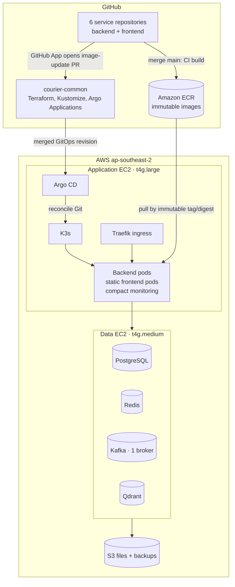
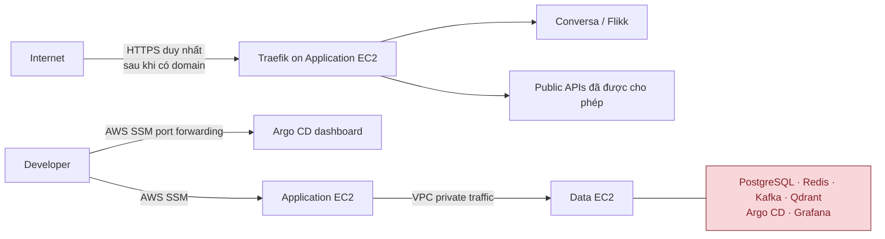
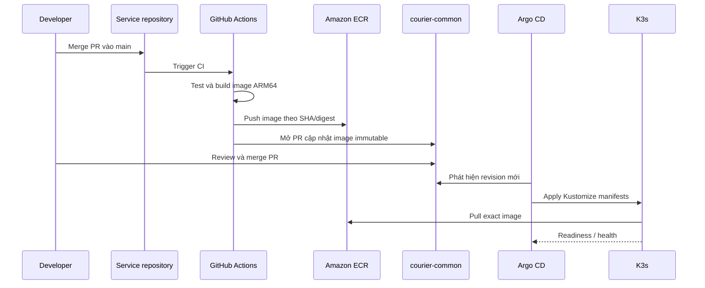
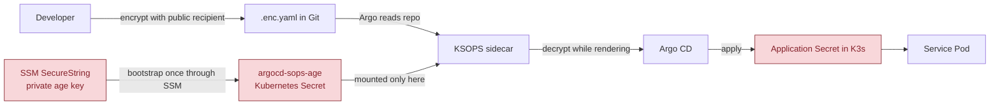

# Hướng dẫn kiến trúc AWS Dev của Courier

Tài liệu này giải thích, bằng ngôn ngữ vận hành, cách môi trường AWS dev của
Courier được tổ chức và cách một thay đổi đi từ mã nguồn tới Kubernetes. Đây là
**môi trường development/demo tiết kiệm chi phí**, không phải kiến trúc
production có tính sẵn sàng cao.

Tài liệu kế hoạch và số liệu chi tiết nằm tại
[`docs/aws-dev-plan.md`](../aws-dev-plan.md). Các hướng dẫn thao tác cụ thể
nằm ở [Argo CD](aws-argocd.md) và [SOPS](aws-sops.md).

## 1. Bức tranh trong một phút

Courier có hai máy EC2 riêng biệt:

- **Application EC2** chạy K3s, Argo CD, Traefik và toàn bộ application pods.
- **Data EC2** giữ PostgreSQL, Redis, Kafka một broker và Qdrant trên volume
  bền vững.

`courier-common` là repository GitOps/DevOps trung tâm: Terraform định nghĩa
AWS, Kubernetes manifests định nghĩa workload, còn Argo CD đọc Git và áp dụng
trạng thái mong muốn vào K3s. Mỗi repository service chỉ chịu trách nhiệm xây
image của chính nó; không service nào tự SSH vào AWS để deploy.

## 2. Ranh giới và trách nhiệm

| Thành phần | Nơi sở hữu | Vai trò | Có public không? |
| --- | --- | --- | --- |
| Terraform | `courier-common/infra/terraform/aws-dev` | VPC, EC2, EBS, IAM, S3, ECR, alerts và Terraform state | Không |
| K3s + Argo CD | Application EC2 | Điều phối workload và đồng bộ GitOps | Argo CD private |
| Traefik | Application EC2 | Điểm vào HTTP/HTTPS cho ứng dụng | Chỉ HTTPS khi có domain/DNS |
| Application pods | K3s | user, chat, payment, agent, Conversa, Flikk | Qua Traefik khi cần |
| Data services | Data EC2 | PostgreSQL, Redis, Kafka, Qdrant | Private trong VPC |
| S3 | AWS | file ứng dụng và backup | Không public mặc định |
| GitHub Actions | GitHub | test, build image ARM64, mở PR cập nhật image | Không có AWS key dài hạn |

Hai EC2 không tạo HA: Application EC2 hoặc Data EC2 hỏng đều làm một phần hệ
thống ngừng hoạt động. Đây là đánh đổi có chủ đích để giữ chi phí development
gần USD 50/tháng; dữ liệu quan trọng cần backup S3 và kiểm tra restore.

### Public và private

Không mở public database, Kafka, Redis, Qdrant, Argo CD hay Grafana. Việc quản
trị dùng AWS Systems Manager (SSM), vì vậy không cần mở SSH inbound.

## 3. Luồng triển khai một service

Khi pipeline hoàn chỉnh, việc release không dùng `latest` và không đẩy image
trực tiếp từ laptop.

Ý nghĩa của bước PR GitOps là mọi deploy đều có lịch sử review rõ ràng: biết
image nào đang chạy, ai phê duyệt và có thể rollback bằng Git revert. Argo CD
chỉ đồng bộ Git; nó không build image và không giữ GitHub credential của từng
service.

### Vai trò GitHub App

Service workflow cần quyền ghi vào **chỉ** repository `courier-common` để mở
PR ảnh mới. Thay vì dùng personal access token, GitHub App tạo token ngắn hạn
và bị giới hạn repository. Private key của App nằm trong GitHub Actions
Secrets của các service repository; App chỉ cần quyền `Contents: Read/Write`
và `Pull requests: Read/Write` cho `courier-common`.

## 4. Cấu hình và secret: vì sao dùng SOPS + age

Config không nhạy cảm (port, hostname, feature flag) được đưa vào ConfigMap
hoặc Kustomize. Secret (DSN, Redis password, OAuth, SePay, AI API key...) không
được commit dạng plaintext.

Điểm quan trọng:

1. Public age recipient trong `.sops.yaml` có thể commit; nó chỉ dùng để mã
   hóa, không thể giải mã.
2. Private age key chỉ có trong AWS SSM Parameter Store (SecureString), sau đó
   được bootstrap vào Secret `argocd-sops-age` trên cluster. Nó không nằm trong
   Git, Terraform state hay log.
3. KSOPS chạy là sidecar riêng của `argocd-repo-server`; đây là container duy
   nhất mount private key. Container repo-server chính không có mount đó.
4. File Git chỉ giữ `*.enc.yaml`; Argo render ra Kubernetes Secret tại thời
   điểm reconcile. Tránh in `Secret.data` trong terminal, log CI hoặc ảnh chụp
   màn hình.

## 5. Trạng thái hiện tại

Mốc trạng thái: **2026-10-23**. “Đã xác minh” bên dưới dựa trên lệnh AWS/K3s
thành công; “chờ áp dụng” không được xem là đã vận hành chỉ vì source đã merge.

| Hạng mục | Trạng thái | Ghi chú |
| --- | --- | --- |
| Terraform remote state | Đã xác minh | S3 state bucket và DynamoDB lock table đã được tạo ở `ap-southeast-2`. |
| AWS nền tảng | Đã xác minh | VPC, hai EC2 ARM, EBS, ECR repositories, S3 buckets, budget/alert và IAM roles được Terraform quản lý. |
| K3s | Đã xác minh | Chạy trên Application EC2; pod CIDR và service CIDR tách với VPC CIDR. |
| Argo CD | Đã xác minh | Cài đặt trên K3s; dashboard private qua SSM tunnel. |
| SOPS age key | Đã xác minh | Private key ở SSM SecureString, bootstrap Secret `argocd-sops-age` tồn tại trong namespace `argocd`. |
| KSOPS source | Đã merge | PR #100 đã thêm sidecar patch, validation manifest và runbook vào `main`. |
| KSOPS runtime | **Chờ áp dụng** | Kiểm tra Deployment hiện tại cho thấy `argocd-repo-server` chưa có container `ksops`; ConfigMap/plugin và validation Application cũng chưa được apply lên cluster. |
| Service workloads | Chưa deploy | ECR chưa có image release được Argo tham chiếu; data stack và image-promotion flow còn phải hoàn tất. |
| Public HTTPS | Chưa triển khai | Chưa có domain/DNS; không tạo public endpoint cho admin/data services. |

## 6. Vận hành hằng ngày

### Bắt đầu một phiên làm việc

1. Start Application EC2 và Data EC2.
2. Chờ SSM `Online`, K3s node `Ready`, rồi kiểm tra Argo CD pods `Running`.
3. Khi cần dashboard, tạo SSM port-forward tới port `8080` trên Application
   EC2 và mở `https://localhost:8080`.
4. Làm việc qua PR: source PR trước, rồi GitOps image-update PR.

Không cần mở SSH hay public Argo CD để xem dashboard. Lệnh cụ thể nằm trong
[runbook Argo CD](aws-argocd.md).

### Kết thúc phiên làm việc

1. Xác nhận backup/migration hoặc workload quan trọng không còn chạy.
2. Stop **cả hai** EC2 để giảm compute cost; EBS, S3 và public IPv4 vẫn có thể
   phát sinh chi phí nhỏ khi instance dừng.
3. Không xóa EBS volume, S3 bucket hoặc Terraform state để “tiết kiệm” nếu chưa
   có quy trình recovery được review.

### Rollback

- **Image/application:** revert GitOps PR để Argo CD đưa workload về image
  immutable trước đó.
- **Kubernetes manifest:** revert commit trong `courier-common`; Argo CD tự
  reconcile revision đã revert.
- **Database:** không rollback schema tự động. Dùng migration expand/contract,
  backup và restore drill đã được xác minh.
- **Infrastructure:** dùng Terraform plan trước, rồi apply revision đã review;
  không sửa thủ công tài nguyên mà Terraform đang quản lý trừ thao tác break-glass
  được ghi nhận.

## 7. Thứ tự công việc tiếp theo

1. Apply KSOPS patch từ `infra/argocd/aws-dev/ksops/` trên Application EC2 và
   xác minh Application `sops-validation-dev` là `Synced` + `Healthy`.
2. Hoàn tất GitHub App cho image promotion, sau đó cấu hình workflows của sáu
   service để publish ECR image ARM64 theo SHA/digest và mở GitOps PR.
3. Triển khai Data EC2 stack với persistent data volume, backup S3 và private
   service discovery từ K3s.
4. Tạo encrypted Secrets thật theo contract từng service, deploy lần lượt và
   đo CPU/RAM/disk/DB connections ngay trên EC2.
5. Chỉ sau khi có domain/DNS và kiểm tra OAuth/CORS/callback, cấu hình HTTPS
   public qua Traefik.

## 8. Những tài liệu nên đọc theo tình huống

| Khi cần... | Đọc |
| --- | --- |
| Số liệu sizing, chi phí, roadmap P0–P3 | [`docs/aws-dev-plan.md`](../aws-dev-plan.md) |
| Cài Argo CD, tunnel dashboard, troubleshoot | [`docs/devops/aws-argocd.md`](aws-argocd.md) |
| Bootstrap/rotate SOPS key, KSOPS | [`docs/devops/aws-sops.md`](aws-sops.md) |
| Hiểu ownership của service/contracts | [`docs/service-map.md`](../service-map.md) |
| Terraform commands và ownership | [`infra/terraform/aws-dev/README.md`](../../infra/terraform/aws-dev/README.md) |

Khi cập nhật tài liệu này, luôn ghi rõ điều gì đã được lệnh thực tế xác minh và
điều gì mới là kế hoạch. Điều đó đặc biệt quan trọng với cost, secret và trạng
thái deploy.
